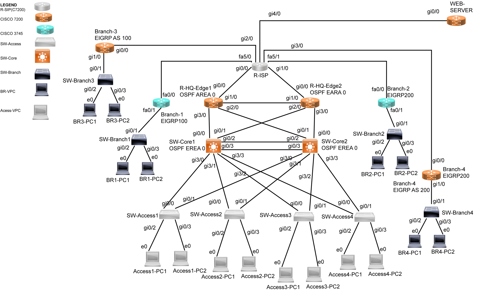

# 본사-지사 통합 네트워크 구축 및 이중화

본사와 지사를 VPN으로 연결하고, 장비나 연결 경로에 문제가 생겼을 때 대체 경로로 통신할 수 있도록 구성한 네트워크 실습 프로젝트입니다.

본사 내부망의 게이트웨이 이중화부터 지사 VPN, 라우팅 연동과 인터넷 통신까지 구성했습니다. 코어·엣지·터널을 중단하고 복구하는 시험을 통해 역할과 경로의 변화를 확인했습니다.

## 프로젝트 개요

| 항목 | 내용 |
| --- | --- |
| 기간 | 2026.06 - 2026.07 |
| 참여 | 송용 · 남기석 |
| 실습 환경 | Cisco IOS, GNS3 |
| 본사 내부망 | VLAN 10·20·30·40·99, VTP v3, LACP, Rapid PVST+, HSRP·Track |
| 라우팅 | OSPF Area 0, EIGRP 100·200, 경로 재분배와 태그 기반 필터링 |
| 지사 연결 | 이중 허브 DMVPN, GRE over IPsec 주·백업 터널 |
| 인터넷 통신 | VPN 트래픽의 NAT 제외, 인터넷 통신을 위한 PAT |

## 구성도

### 구성 1. 본사와 지사 4곳을 연결한 이중 허브 DMVPN



### 구성 2. 지사 2곳의 GRE over IPsec 주·백업 경로


두 구성은 장비와 주소 체계가 다른 별도의 실습 환경입니다. 상세 주소와 연결 관계는 [전체 구성 문서](docs/02-architecture.md)에 정리했습니다.

## 주요 구성과 확인 내용

| 구분 | 구성한 내용 | 확인한 내용 |
| --- | --- | --- |
| 내부망과 링크 | VLAN으로 망 분리, LACP로 링크 묶음, Rapid PVST+ 적용 | VLAN별 STP Root와 링크 상태 |
| 게이트웨이 이중화 | HSRP 역할 분담과 Track 설정 | 코어 중단·복구 시 Active 역할 변화 |
| 라우팅 연동 | OSPF·EIGRP 재분배, Route Map과 태그 적용 | 라우팅 테이블과 엣지 장애 시 우회 경로 |
| 본사-지사 VPN | DMVPN, GRE over IPsec 주·백업 경로 | 터널 중단 시 대체 경로와 복구 후 주 경로 복귀 |
| 인터넷 통신 | VPN 트래픽과 인터넷 트래픽을 구분한 NAT/PAT | 장비별 Inside/Outside 설정과 인터넷 통신 |

검증 내용은 당시 발표 자료의 기록을 기준으로 정리했습니다. 이번 저장소 정리 과정에서 장비를 다시 실행하거나 전환 시간·패킷 손실률을 새로 측정하지는 않았습니다. 시험별 확인 범위와 재시험 절차는 [장애 전환과 검증 기록](docs/06-validation.md)에서 확인할 수 있습니다.

## 프로젝트 문서

| 문서 | 내용 |
| --- | --- |
| [프로젝트 개요](docs/01-overview.md) | 목표, 진행 과정, 팀 작업 범위 |
| [전체 구성](docs/02-architecture.md) | 두 토폴로지의 장비, VLAN, 주소와 통신 흐름 |
| [본사 내부망과 이중화](docs/03-switching-ha.md) | VLAN·LACP·STP·HSRP·Track의 역할과 설정 |
| [라우팅과 재분배](docs/04-routing.md) | OSPF·EIGRP, Route Map, 태그와 경로 선택 |
| [VPN과 인터넷 통신](docs/05-vpn-nat.md) | DMVPN, GRE over IPsec, NAT/PAT 설정과 확인 명령 |
| [장애 전환과 검증](docs/06-validation.md) | 당시 시험 기록, 확인 범위와 재시험 순서 |
| [설정 확인·보완 사항](docs/07-findings.md) | 원본 설정의 누락 명령, 설명과 설정의 차이 |
| [명령어와 점검 순서](docs/08-runbook.md) | 정상 상태 조회, 장애 발생과 복구 시 점검 절차 |
| [출처와 작성 기준](docs/10-sources.md) | 원본 자료와 기술 참고 문서 |

## 설정 파일 참고 사항

- `configs/`는 원본 설정에서 비밀번호와 인증키를 대체한 보관본입니다.
- 원본에 남아 있는 미완성 명령과 메모를 포함하므로, 일괄 실행용 스크립트로 사용하지 않습니다.
- DMVPN Phase 설명과 HSRP Track·Preempt 조건 등 재확인이 필요한 항목은 [설정 확인·보완 사항](docs/07-findings.md)에 구분했습니다.

## 파일 구성

```text
README.md               # 프로젝트 소개
assets/                 # 두 토폴로지 구성도
docs/                   # 구성 설명, 설정과 검증 기록, 점검 절차
configs/topology1/      # 구성 1의 장비별 설정
configs/topology2/      # 구성 2의 라우터·스위치 통합 설정
source-manifest.json    # 원본 자료의 상대 경로와 해시
```
