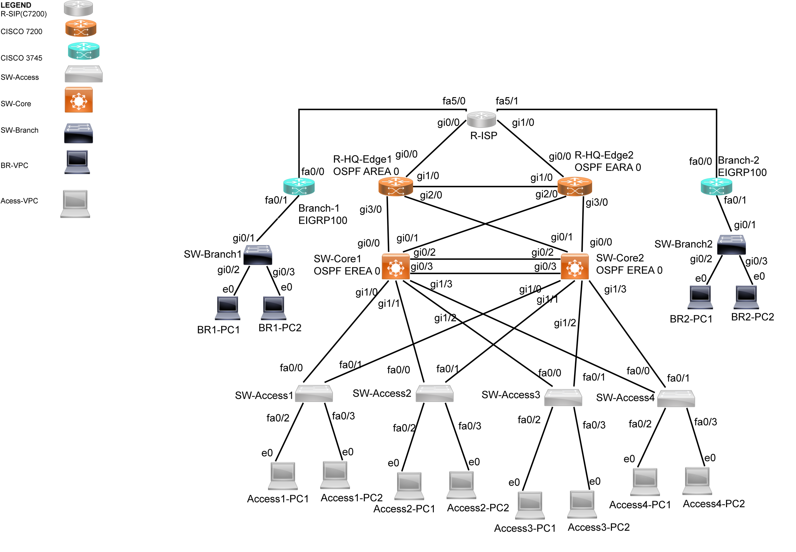
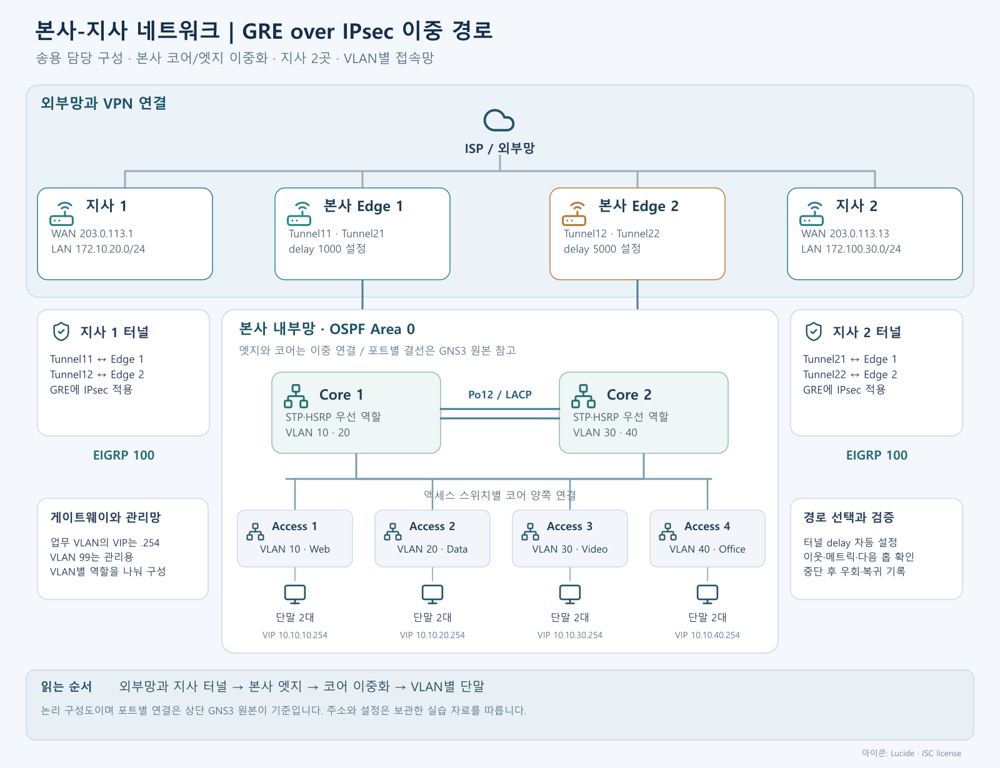

# 본사-지사 네트워크 구축 및 이중화

본사와 지사 2곳을 GRE over IPsec으로 연결하고, 주 경로에 문제가 생겼을 때 예비 터널로 통신할 수 있도록 구성한 네트워크 실습 프로젝트입니다.

송용이 담당한 구성과 설정, 관련 검증 기록을 정리했습니다. 본사 내부망의 VLAN·게이트웨이 이중화부터 OSPF·EIGRP 연동, VPN과 인터넷 통신을 다룹니다.

## 프로젝트 개요

| 항목 | 내용 |
| --- | --- |
| 기간 | 2026.06 - 2026.07 |
| 담당 | 송용 |
| 환경 | GNS3, Cisco IOS |
| 규모 | 본사 코어 2대·엣지 2대·액세스 4대, 지사 2곳 |
| 내부망 | VLAN 10·20·30·40·99, VTP v3, LACP, Rapid PVST+, HSRP·Track |
| 라우팅 | 본사 OSPF Area 0, 지사 EIGRP 100, 양방향 재분배·태그 |
| VPN | GRE over IPsec, Tunnel11·12·21·22 |
| 인터넷 통신 | NAT/PAT 설정, 내부·지사 통신의 변환 대상 구분 |

## 구성도

### GNS3 원본 토폴로지



### 역할과 통신 흐름을 정리한 아이콘 구성도



아이콘 구성도는 역할과 연결 흐름을 설명하는 논리 구성도입니다. 실제 포트 결선은 위 GNS3 원본을 기준으로 확인합니다. [SVG 원본](assets/network-overview.svg)도 함께 제공합니다.

## 주요 수행 내용

| 영역 | 구성한 내용 | 확인 기준 |
| --- | --- | --- |
| 본사 내부망 | VLAN 분리, VTP v3, 코어 간 LACP Port-channel 12 | VLAN·Trunk·Port-channel 상태 |
| 내부 경로와 게이트웨이 | Rapid PVST+와 VLAN별 HSRP 역할 분담 | STP Root, HSRP Active·Standby, Track 상태 |
| 라우팅 연동 | 본사 OSPF와 지사 EIGRP의 재분배, 태그 필터 | OSPF·EIGRP 이웃과 라우팅 테이블 |
| 본사-지사 VPN | GRE 터널에 IPsec 적용, 터널 delay 차등 설정 | 터널 상태, IPsec SA·암복호화 카운터, 실제 경로 |
| 주·백업 전환 | Tunnel21 중단과 Tunnel22 우회, 복구 후 경로 복귀 | 당시 발표 기록과 재시험 절차 |
| 인터넷 통신 | NAT ACL, Inside/Outside, PAT 설정 | ACL과 NAT 변환 상태 |

설정 파일에서 확인한 내용과 당시 발표 자료의 시험 기록을 구분했습니다. 이번 문서 정리에서 장비를 다시 실행하거나 전환 시간·패킷 손실률을 새로 측정하지는 않았습니다.

## 프로젝트 문서

| 문서 | 내용 |
| --- | --- |
| [프로젝트 개요](docs/01-overview.md) | 목표와 담당 범위, 진행 과정 |
| [전체 구성](docs/02-architecture.md) | 장비 역할, VLAN·WAN·터널 주소 |
| [본사 내부망과 이중화](docs/03-switching-ha.md) | VTP·LACP·STP·HSRP·Track 설정 |
| [라우팅과 재분배](docs/04-routing.md) | OSPF·EIGRP, 태그 필터와 경로 선택 |
| [VPN과 인터넷 통신](docs/05-vpn-nat.md) | GRE over IPsec, 터널 우선순위와 NAT/PAT |
| [검증 기록과 확인 범위](docs/06-validation.md) | 기존 기록, 설정 확인과 추가 검증 항목 |
| [설정 확인·보완 사항](docs/07-findings.md) | 주소표 차이, VLAN·NAT 설정의 재확인 항목 |
| [명령어와 점검 순서](docs/08-runbook.md) | 정상 상태 조회, 터널 중단·복구 절차 |
| [출처와 작성 기준](docs/10-sources.md) | 보관한 원본과 문서 작성 범위 |

## 설정 파일 참고 사항

`configs/topology2/`에는 본인이 담당한 구성의 라우터·스위치 설정과 터널 주소 메모만 남겼습니다. 인증값은 대체했으며, 원본의 주석·중복·작업 메모는 보존했습니다. 일괄 실행용 스크립트는 아닙니다.

## 파일 구성

```text
README.md                 # 프로젝트 소개
assets/topology-2.png      # GNS3 원본 토폴로지
assets/network-overview.*  # 아이콘 구성도 PNG·SVG
docs/                     # 구성·설정·검증·점검 문서
configs/topology2/         # 담당 구성의 설정 보관본
source-manifest.json      # 원본 파일의 출처·해시
```
