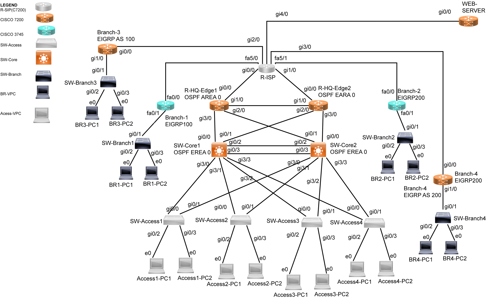
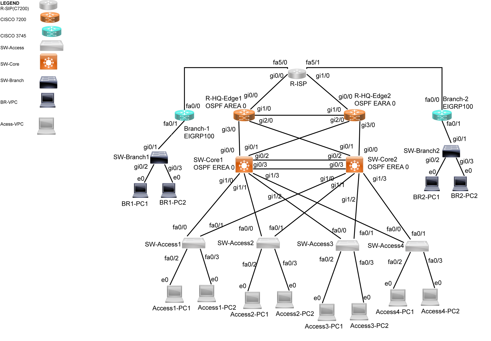

# 전체 구성과 통신 흐름

## Topology 1 — 이중 허브 DMVPN



본사는 Core1·Core2와 Edge1·Edge2로 구성하고, 액세스 스위치는 두 코어로 연결했습니다. 지사는 ISP 역할 라우터를 통해 본사 엣지에 접근합니다. Tunnel0과 Tunnel1은 서로 다른 오버레이 대역으로 구분했습니다.

| 구간 | 주소·역할 | 기준 |
| --- | --- | --- |
| VLAN 10 / Data | 10.10.10.0/24, VIP 10.10.10.1 | Core1 Root·Active |
| VLAN 20 / Voice | 10.10.20.0/24, VIP 10.10.20.1 | Core1 Root·Active |
| VLAN 30 / Server | 10.10.30.0/24, VIP 10.10.30.1 | Core2 Root·Active |
| VLAN 40 / Guest | 10.10.40.0/24, VIP 10.10.40.1 | Core2 Root·Active |
| VLAN 99 / Mgmt | 10.10.99.0/24, VIP 10.10.99.1 | Core1 Root·Active |
| 코어 SVI | Core1 .2, Core2 .3 | Topology 1 |
| Edge1 WAN | 203.0.113.6/30, ISP .5 | 원본 인터페이스 설정 |
| Edge2 WAN | 203.0.113.10/30, ISP .9 | 원본 인터페이스 설정 |
| Tunnel0 | 172.16.0.0/24 | 허브 .1/.2, BR1 .11, BR2 .22 |
| Tunnel1 | 172.16.10.0/24 | 허브 .1/.2, BR3 .33, BR4 .44 |
| 본사 내부 L3 링크 | 172.168.10.0 범위의 /30 링크 | 아래 주의 참조 |

172.168.10.0, 172.10.20.0, 172.100.30.0, 172.200.40.0 등 원본의 일부 내부 주소는 RFC1918 사설 대역이 아닙니다. 재현 시 실제 인터넷에 연결된 환경에서 그대로 사용하지 말고 주소 계획부터 다시 정합니다. 여기서는 과거 실습 설정을 설명하기 위해 원본을 보존했습니다.

## 요청 흐름

```text
본사 PC → 액세스 VLAN → HSRP 가상 게이트웨이 → 본사 L3 경로
  → Edge → VPN 터널 → 지사 LAN

인터넷 목적지 → Edge의 NAT 대상 판단 → PAT → ISP 역할 라우터
```

VLAN 분리만으로 VLAN 간 접근이 차단되는 것은 아닙니다. NAT에 연결한 ACL의 deny는 해당 NAT 규칙의 변환 대상에서 제외한다는 의미이며, 인터페이스 보안 정책의 패킷 차단과 구분합니다.

## Topology 2 — GRE over IPsec



| 항목 | Topology 1 | Topology 2 |
| --- | --- | --- |
| 지사 연결 | DMVPN 이중 허브, 지사 4곳 | 지사 2곳과 point-to-point GRE |
| 지사 라우팅 | EIGRP 100·200 | EIGRP 100 |
| VLAN 10~40 VIP | 각 대역 .1 | 각 대역 .254 |
| 주 코어 우선순위 | 110, 장애 시 20 감소 | 150, 장애 시 100 감소 |
| 코어 Port-channel | Po1 | Po12 |
| 터널 | Tunnel0·Tunnel1 | Tunnel11·12·21·22 |

두 구성을 하나의 설정 파일처럼 섞지 않습니다. VLAN 99도 Topology 2 원본은 Core1 .1 / Core2 .2이며, Topology 1의 관리 VIP 구성을 그대로 적용한 것으로 설명하지 않습니다.

## 자료 간 차이

Topology 2의 Tunnel21·22 주소는 발표 표와 컨피그가 다릅니다. 원본 Router-Config 기준 Tunnel21은 BR2 192.168.20.1 ↔ Edge1 192.168.20.2, Tunnel22는 BR2 192.168.20.5 ↔ Edge2 192.168.20.6입니다. 실행 장비의 show running-config가 없는 상태에서 발표 표를 정답으로 단정하지 않습니다.
